# NexHub

> Windows 桌面文件共享 & RDP 主机客户端 —— PyQt6 + PyQt-Fluent-Widgets + 内嵌 FastAPI + ECS 后端 + 阿里云 OSS + nps 内网穿透

NexHub 面向个人和可信好友小范围使用：在本机一键发布文件/文件夹，其他人通过桌面客户端或网页浏览、选择性下载；同时内置 RDP 主机管理，直接调用 Windows 原生 `mstsc.exe` 发起远程桌面，并支持经 NPS 隧道访问内网主机。

**Fluent Design · 默认深色主题 · FluentWindow 可折叠侧边栏 · 圆角卡片 · 深浅主题一键切换 · OSS 密钥只存在 ECS 后端**

[](https://github.com/mouchenguo/NexHub/releases)
[](https://github.com/mouchenguo/NexHub/releases/tag/v0.1.6-beta)
[](https://www.python.org/)

## 下载

| 文件 | 说明 |
| --- | --- |
| [`NexHub-Setup-0.1.6-beta.exe`](https://github.com/mouchenguo/NexHub/releases/download/v0.1.6-beta/NexHub-Setup-0.1.6-beta.exe) | Windows 10 / 11 x64 安装包（推荐） |
| [`NexHub-v0.1.6-beta-win64.zip`](https://github.com/mouchenguo/NexHub/releases/download/v0.1.6-beta/NexHub-v0.1.6-beta-win64.zip) | onedir 便携版 |
| [`NexHub-v0.1.6-beta.exe`](https://github.com/mouchenguo/NexHub/releases/download/v0.1.6-beta/NexHub-v0.1.6-beta.exe) | 旧客户端单文件回退（优化后 onefile） |
| [`NexHub-Server-Deploy.zip`](https://github.com/mouchenguo/NexHub/releases/download/v0.1.6-beta/NexHub-Server-Deploy.zip) | 服务端一键部署包（含安装脚本） |
| [`NexHub-Server-Bundle.zip`](https://github.com/mouchenguo/NexHub/releases/download/v0.1.6-beta/NexHub-Server-Bundle.zip) | 仅服务端程序包，适合手动升级 |

> GitHub Release 同时保留安装包、onedir 便携版和旧客户端单文件回退资产；旧客户端通过 `latest.json` 继续获得优化后的单文件 exe。

## 网页入口

生产环境把站点统一放在 `/nexhub` 前缀下：

| 入口 | 地址 | 说明 |
| --- | --- | --- |
| 主站 / 产品介绍 | `http://47.108.130.177:8000/nexhub` | 访问根路径 `/` 自动跳转到这里 |
| 客户端下载 | `http://47.108.130.177:8000/nexhub/downloads` | 只展示客户端、服务端部署包和校验信息 |
| 插件广场介绍 | `http://47.108.130.177:8001/nexhub` | 独立插件系统的介绍页 |
| 插件广场 | `http://47.108.130.177:8001/nexhub/plugin` | 浏览、下载、上传插件 |
| 插件审核 | `http://47.108.130.177:8001/nexhub/plugin/review` | 站内登录页 + 会话 Cookie；密码文件为服务端 `/opt/nexhub/plugin-market/review_password.txt` |
| 管理后台 | `http://47.108.130.177:8000/admin` | 主站右上角和页脚只保留小入口 |

旧的 `/downloads/latest.json` 仍保留兼容路由，已经安装的客户端检查更新不会失效；新的下载页使用 `/nexhub/downloads`。

## 版本策略

- `v1.0.0` 之前所有版本都是预发行版，版本号统一带 `-beta` 后缀，例如 `v0.1.5-beta`。
- GitHub Release 在 `v1.0.0` 之前都标记为 **Pre-release**，不作为稳定发行版。
- `v1.0.0` 才是第一个正式发行版；达到该版本后再按正常稳定版策略发布。
- 发布 tag 与版本号保持一致；主安装包使用 `NexHub-Setup-v<版本>.exe`，另保留 `NexHub-v<版本>.exe` 作为旧客户端自动更新过渡资产。

## 界面预览

| 客户端 · 仪表盘（深色） | 客户端 · 仪表盘（浅色） |
| --- | --- |
| 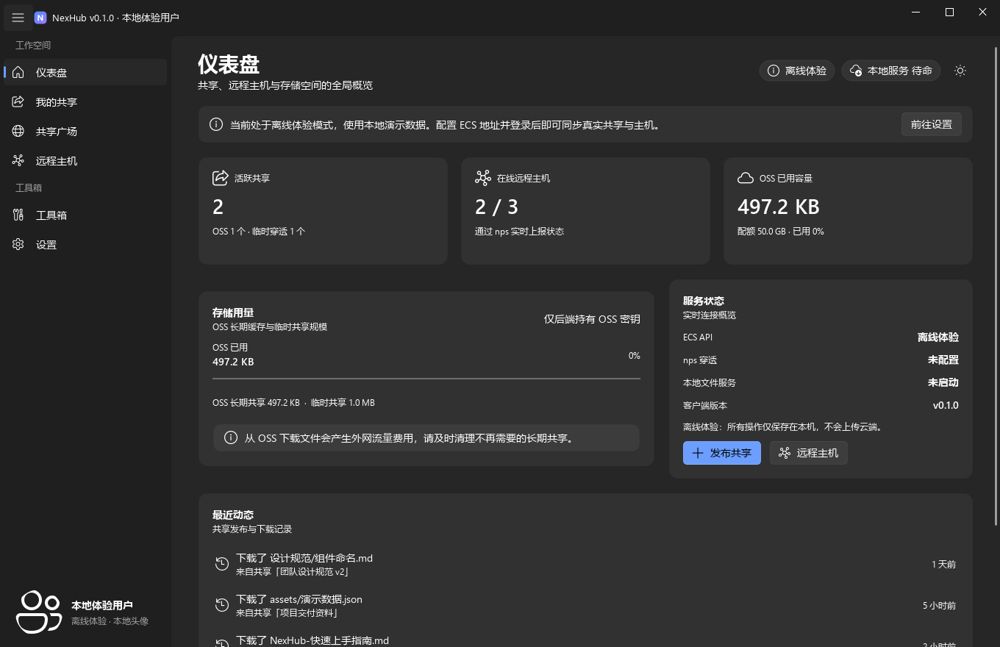 | 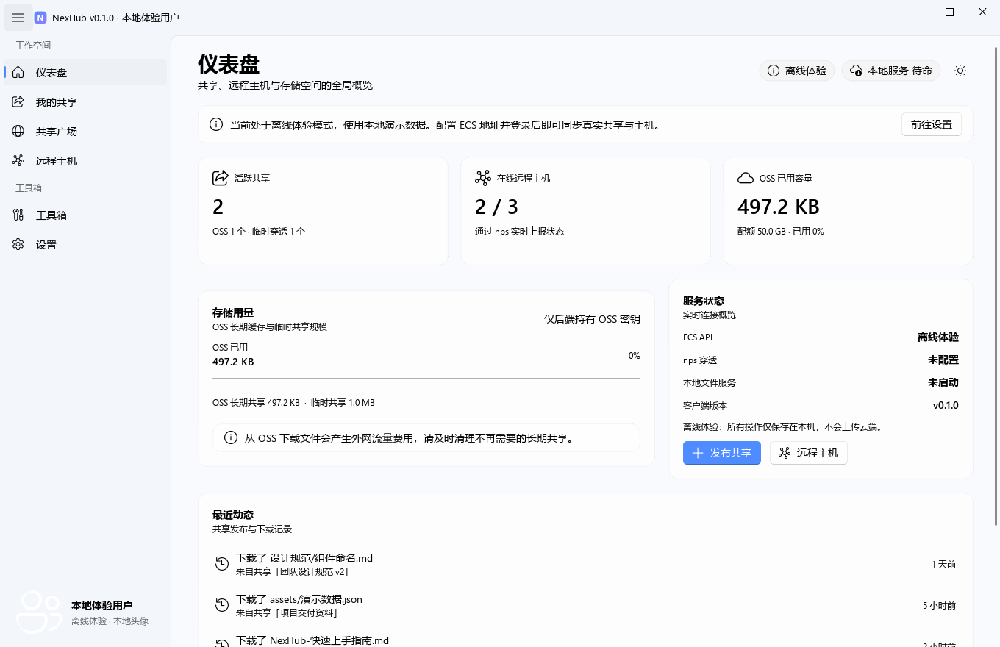 |

| 客户端 · 共享广场 | 客户端 · 发布共享 |
| --- | --- |
| 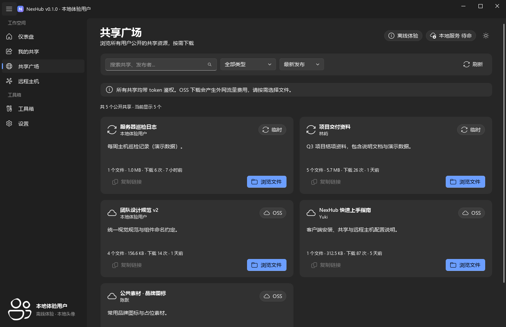 | 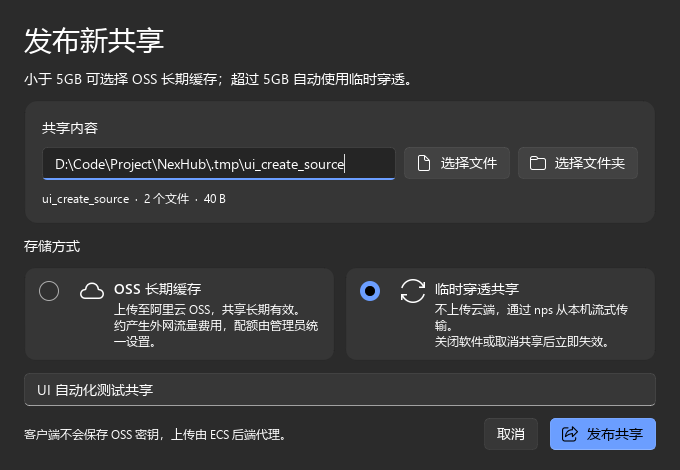 |

| 客户端 · 选择性下载 | 客户端 · 设置 |
| --- | --- |
| 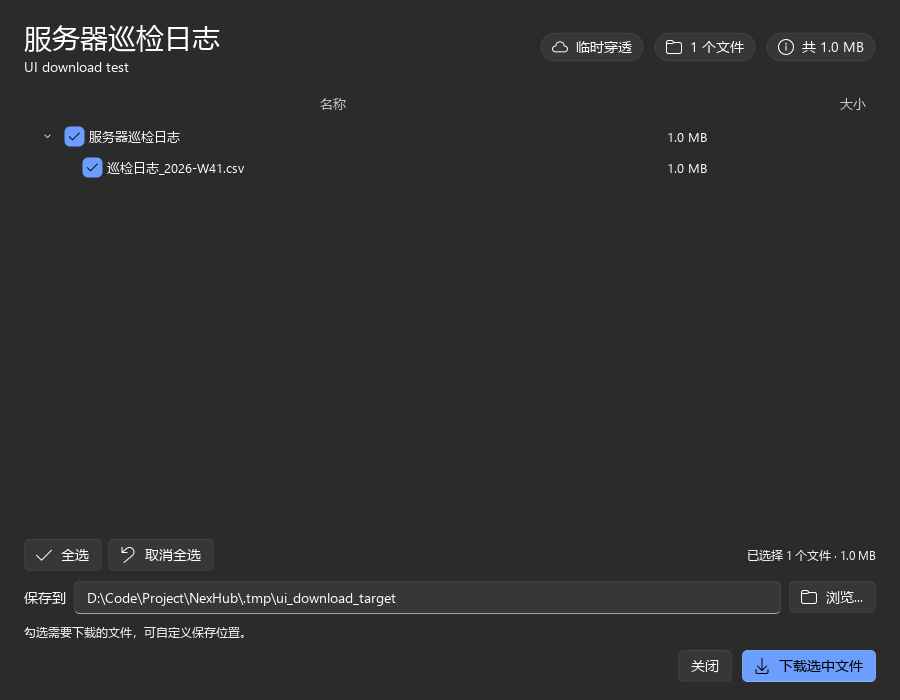 | 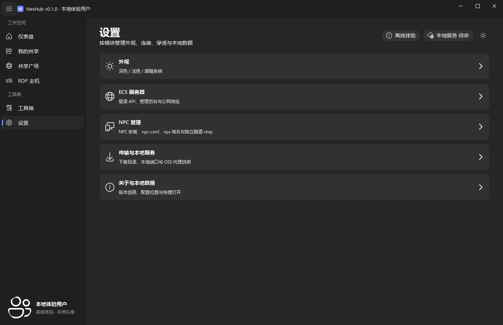 |

| 客户端 · 注册（服务端自动审核） |
| --- |
| 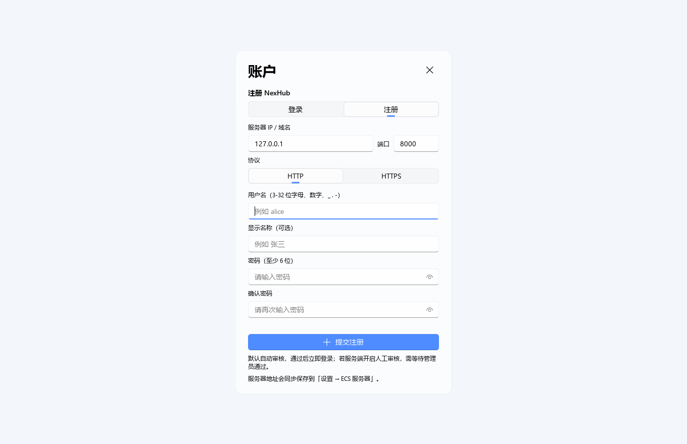 |

| 客户端 · RDP 主机 | 客户端 · 工具箱 |
| --- | --- |
| 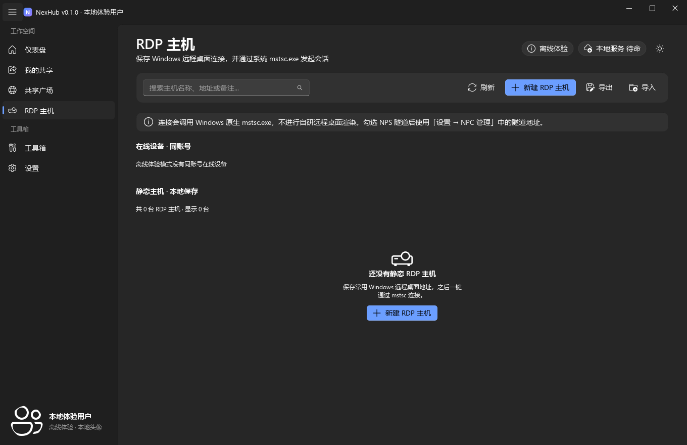 | 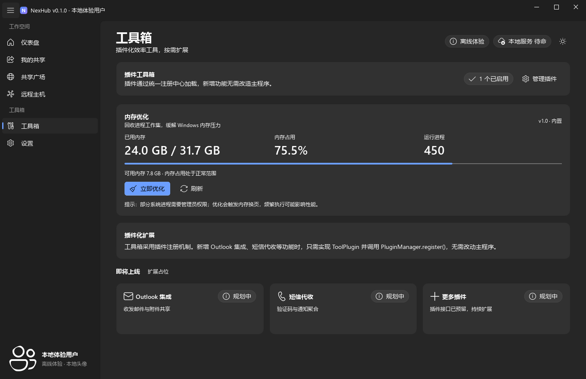 |

| ECS 管理后台 · 仪表盘 | ECS 管理后台 · 用户管理 |
| --- | --- |
| 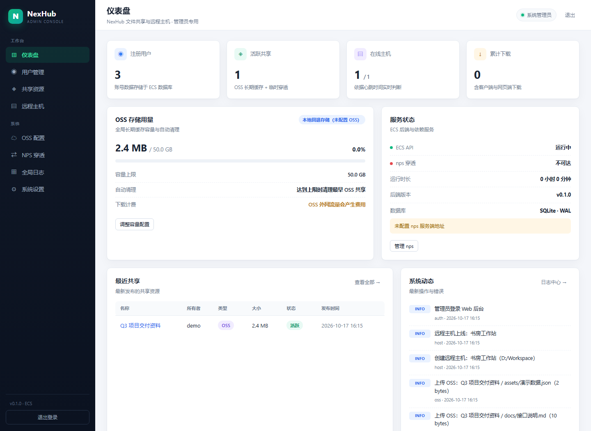 | 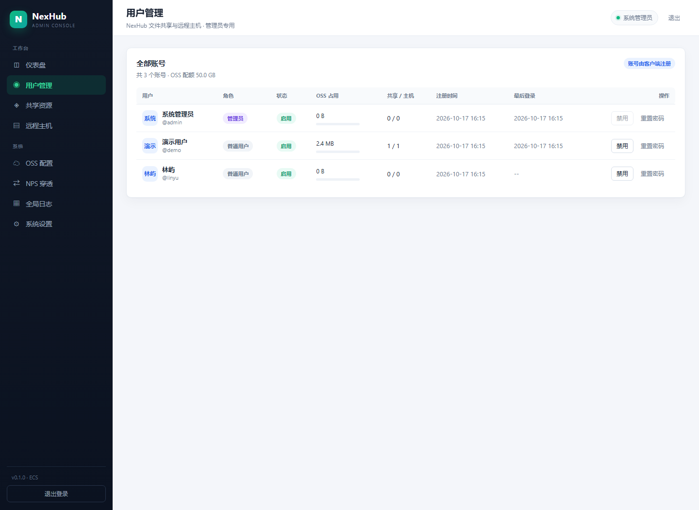 |

| 网页端备用分享页 | 管理后台 · OSS 配置 |
| --- | --- |
| 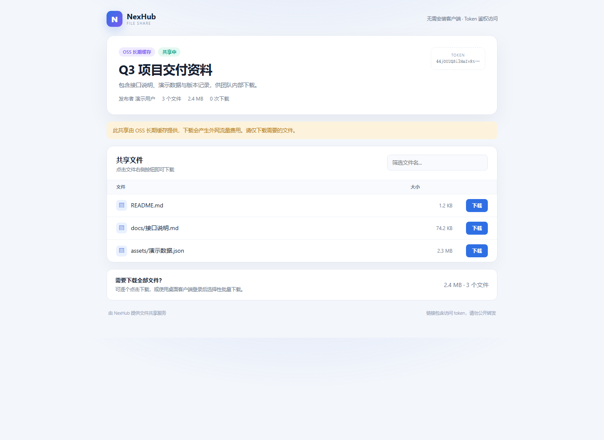 | 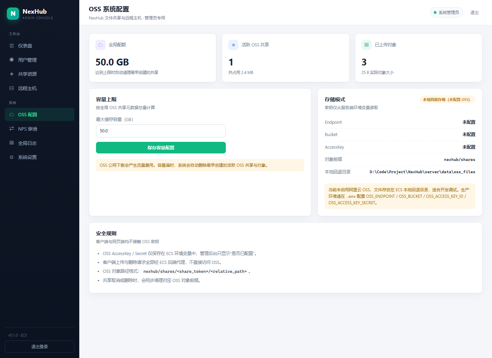 |

> 截图中的共享数据来自客户端离线演示模式或联调测试数据。

## 功能清单

### Windows 客户端（PyQt6 + PyQt-Fluent-Widgets）

- **账号系统**：主界面左下角显示「请登录」，点击后打开居中的内嵌登录面板；支持登录 / 注册切换、用户名或昵称登录（UTF-8 + Unicode NFC 统一处理）、记住我（DPAPI 加密凭证）、自动登录、修改昵称、修改密码、退出登录；注册默认由服务端自动审核通过，也可切换为人工审核；服务器地址在设置页配置，**不硬编码 ECS IP**。
- **单实例运行**：重复启动不会创建新窗口，而是通过本地 IPC 唤起已有实例（包括已关闭窗口并隐藏到托盘的情况）。
- **窗口行为**：最小化保留在任务栏；点击关闭按钮才隐藏到托盘；托盘菜单仅保留「显示 NexHub / 退出 NexHub」。设置 → 启动可开启开机自启，自启时只驻留托盘。
- **安装布局**：正式安装包使用 Inno Setup 安装到 `C:\Program Files\NexHub`，程序采用 onedir 拆分文件；配置、日志、插件和演示数据保留在 `%APPDATA%\NexHub`，避免向 Program Files 写入用户数据。
- **检查更新与下载页**：设置 → 关于与本地数据 → 检查更新，读取 `服务器地址/downloads/latest.json`；启动后登录状态会自动检查一次。新版本优先下载 Inno Setup 安装包并安装到 `Program Files`，旧版客户端仍使用 `download_url` 指向的单文件 exe 过渡。当前已发布版本 `v0.1.5-beta`。
- **仪表盘**：活跃共享、RDP 主机数量、OSS 已用容量、服务状态、最近动态。
- **一键共享**：
  - 自动扫描文件/文件夹并统计大小；
  - 总大小 **< 5GB** 时可选择「OSS 长期缓存」或「临时穿透」；
  - 总大小 **≥ 5GB** 时强制临时穿透，并提示仅支持直连；
  - 临时共享自动启动内嵌 FastAPI（`127.0.0.1:8765`）并注册 token，关闭软件/取消共享即失效；
  - OSS 上传/删除全部由 ECS 后端代理，客户端**不保存任何 OSS 密钥**；
  - 发布完成后可复制网页端分享链接。
- **我的共享**：搜索、按类型/状态筛选、复制链接、取消共享、删除共享。
- **共享广场**：卡片网格、搜索、排序、目录树浏览、勾选部分文件、自定义保存路径、流式下载与进度显示。
- **RDP 主机**：本地保存主机名称、IP/域名、端口、用户名、加密密码和备注；新增/编辑/删除；一键调用 Windows 原生 `mstsc.exe`，优先生成临时 `.rdp` 文件并在会话结束后清理；支持勾选 NPS 隧道并使用 NPC 配置中的 RDP 隧道地址。
- **工具箱（插件广场 + 进程隔离）**：工具箱内提供「已安装」与「插件广场」两个标签；支持远程清单、搜索、分类、安装/更新/卸载、本地 zip 导入。插件在独立宿主进程中运行，单个插件崩溃不会退出主程序。插件可通过 manifest 的 `controls` 声明卡片快捷控件；内存优化支持一键“优化内存”，Clash-Verge内置版支持直接启用/停用和选择节点，快捷操作仍由插件宿主执行。Clash-Verge内置版支持 Clash/Mihomo YAML 订阅（含 hysteria2、anytls 等节点）和 vmess/trojan/ss/vless URI 订阅。内存优化与Clash-Verge内置版均以 zip 插件形式安装，不再内置。设置页可修改插件广场 API 地址。
- **NPC 一键自动配置**：设置 → NPC 与内网穿透 → 「一键自动配置 NPC」；登录后点击即可请求 ECS，服务端幂等创建/修复当前设备的 NPS 主机和 TCP 隧道，客户端自动安装 NPC、写入 `npc.conf`、重启服务，并显示公网 RDP 地址，无需手动填写 vkey。
- **设置 → NPC 管理 → 隧道管理**：三层文件夹式导航；先创建 NPS 主机（一个 vkey），再在主机下创建多条 TCP 隧道。ECS 不会在每条隧道创建时重复新建主机；删除隧道只删除对应 TCP 任务，不删除共享主机。支持将 vkey/NPS 地址下发到本机 `npc.conf`、一键重启 NPC、启停/编辑/删除隧道。发布临时共享时 ECS 会为该共享自动分配公网 TCP 端口并创建 NPS 隧道，取消/删除共享时自动关闭隧道；离线体验使用模拟隧道，不调用真实 NPS、不写本机配置。
- **设置 → NPC 与内网穿透**：内置 NPC 资源，启动时检测 `C:\Program Files\npc\npc.exe`；缺失时经 UAC 自动释放，目录损坏时提示重新解压修复；NPC 只提供「主机 IP（含端口）」和「vkey」两个输入项，保存写入 `C:\Program Files\npc\conf\npc.conf`，支持一键重启 `Npc` 服务；RDP/NPS 隧道地址也在此模块统一维护。
- **个人卡片**：未登录时左下角显示「请登录」，点击打开居中登录面板；登录后展示头像、昵称与角色，可更换头像、修改昵称、修改密码或退出登录。头像直传 ECS 本地存储并以内联图片返回，不使用 OSS。
- **设置页**：文件夹式层级导航，点击条目进入子页面，左上角返回上一级：
  - 外观：深色 / 浅色 / 跟随 Windows 系统主题，保存到本地 JSON；
  - ECS 服务器：IP/域名 + 端口 + HTTP/HTTPS 选择 + 测试连接；
  - NPC 与内网穿透：NPC 安装/修复/重启、`server_addr`、`vkey`、临时共享域名、RDP/NPS 隧道地址；
  - 下载与传输：默认下载路径与 OSS 后端代理说明；
  - 关于与本地数据：本地配置/数据位置。
- **后台线程**：目录扫描、共享发布/OSS 上传、文件下载、服务操作、API 请求均在 `QThread` 中执行，不阻塞 GUI。

#### 客户端 UI 结构（Fluent 重构）

- **主窗口**：`FluentWindow`，使用内置 `NavigationInterface` 可折叠侧边导航；「工作空间」包含仪表盘/共享/广场/RDP 主机，「工具箱」分组只保留工具箱与设置；账号不再占用侧边导航，只在左下角用户卡片展示。
- **页面容器**：`views/base.py::BasePage` 统一提供 `SingleDirectionScrollArea`、页面标题、ECS 连接状态与主题切换按钮；各页面只继承 `QWidget` 并构建内容。
- **仪表盘**：`CardWidget` 圆角卡片 + `StatCard` 统计卡、`ProgressBar` 存储进度、最近动态列表，布局对齐现代 Fluent 仪表盘。
- **Fluent 控件**：`InfoBar`（操作提示）、`PillPushButton`（状态胶囊）、`SegmentedWidget`（主题切换）、`SearchLineEdit`、`ComboBox`、`SpinBox`、`TableWidget`、`TreeWidget`、`PasswordLineEdit`、`AvatarWidget`、`MessageBox`。
- **主题**：`ThemeManager` 调用 `setTheme(Theme.DARK/LIGHT/AUTO)`，默认深色，选择保存到本地 JSON；不手写 QSS，由 qfluentwidgets 自动刷新全部控件。
- **对话框**：发布共享、文件浏览、RDP 主机编辑、修改昵称、修改密码、更新提示均使用 Fluent 组件 + `FluentStyleSheet.DIALOG`；确认操作统一使用 `MessageBox`。
- **设置子模块**：文件夹式列表（外观 / ECS 服务器 / NPC 管理 / 下载与传输 / 关于），点击进入子页面并可返回；NPC 管理下再进入「隧道管理」第三层；不再占用侧边栏。
- **NPC 管理与隧道管理**：设置文件夹内的二级 NPC 子页面，以及其下的「隧道管理」子页面；NPC 安装/写配置/重启通过 `subprocess` + UAC helper 完成；配置写入保留 `npc.conf` 其他隧道配置与注释，nps 域名在同一模块维护。
- **未登录预览**：不再预置演示共享/文件/下载记录；仍可预览所有本地页面与操作，登录后切换到 ECS 云端数据。

### ECS 服务端（FastAPI + Web 管理后台）

- **鉴权**：PBKDF2-HMAC-SHA256 密码哈希 + HMAC-SHA256 自包含 Token（无第三方 JWT 依赖）。
- **头像**：当前用户头像上传到 ECS `data/avatars` 本地磁盘，不使用 OSS；通过鉴权接口内联返回图片，避免浏览器触发下载；支持 PNG/JPG/WebP，最大 5MB。
- **共享 API**：发布、列表、manifest、经后端代理的 OSS 上传、鉴权下载、取消、删除。
- **网页端备用访问**：`/s/<token>` 无需安装客户端，支持文件筛选与下载，token 本身作为访问凭证。
- **NPS 隧道 API**：自动创建独立 NPS 客户端、唯一 vkey、列表、编辑、启停和删除；NPS `auth_key` 仅保存在 ECS 环境变量/管理配置中，不下发客户端。
- **OSS**：
  - oss2 SDK，上传/删除/读取均由后端完成；
  - 全局容量上限，达到上限自动清理**最早创建**的 OSS 共享；
  - 未配置 OSS 时自动回退到 ECS 本地磁盘，便于开发；
  - 下载会产生外网流量费用，客户端和管理后台均有提示。
- **管理后台（1Panel 简约风格）**：
  - 用户管理：查看、注册审核（通过/拒绝）、启用/禁用、重置密码、查看 OSS 占用；
  - 共享资源：筛选、查看访问/下载日志、强制关闭、删除；
  - OSS 配置：容量上限、实际对象统计、存储模式与密钥配置状态；
  - NPS 配置：Bridge 可达性探测、域名/vkey 配置、活跃临时通道关闭；
  - 全局日志：认证、共享、下载、主机、OSS、管理、错误日志；
  - 系统设置：网页域名、注册自动审核开关、轮换后端签名密钥、服务端检查更新、部署信息与安全建议；
  - 服务端检查更新：读取 GitHub Releases（支持预发布），显示当前/最新版本、发布时间、服务端部署包和 SHA-256；只检查版本，不会自动覆盖运行中的服务端。
- **安全细节**：路径穿越防护、`token` 鉴权、管理员 HttpOnly Cookie、安全响应头、文件大小限制、流式传输。

## 架构

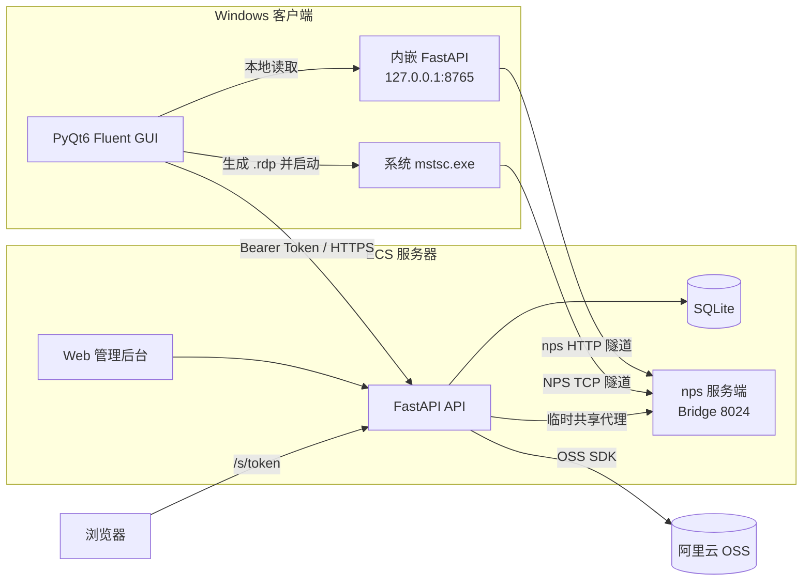

- 客户端所有 API 请求实时读取本地配置中的 `server_url`，ECS 公网 IP 变动后只需在设置页修改地址。
- 临时共享：ECS 保存客户端上报的 nps 域名，下载时由 ECS 流式代理到客户端内嵌服务。
- RDP：客户端只保存本机加密配置，调用 Windows 原生 mstsc.exe；勾选 NPS 时使用 NPC 配置中的隧道地址。
- OSS 密钥只在 ECS 环境变量中；客户端与管理后台都看不到明文。

## 版本兼容

- 服务端 `/api/health`、登录/注册响应会返回 `api_version`、`min_client_version` 和 `features`；响应头同时带 `X-NexHub-Api-Version`。
- 客户端请求带 `X-NexHub-Client-Version` / `X-NexHub-Client-Api-Version`，登录后读取并保存服务端兼容信息。
- 旧服务端（没有 `api_version`）自动进入 legacy 兼容模式：登录、共享、下载、RDP、心跳等核心功能继续可用；NPC 一键自动配置保留尝试入口，若服务端确实不支持会提示升级服务端或手动配置。
- 新服务端对明确上报了过低版本的客户端返回 `426`；未上报版本的旧客户端仍保持兼容。
- 设置 → ECS 服务器会显示服务端版本、API 版本和兼容提示。
- 只有 API 发生不兼容变化时才递增 `API_VERSION`；每次发布仍应递增应用版本号，避免同名 beta 构建无法被更新检查区分。

## 目录结构

```text
NexHub/
├─ client/                      # Windows 客户端（独立目录）
│  ├─ main.py                   # 入口 / 登录会话控制 / NPC admin helper
│  ├─ requirements.txt
│  ├─ requirements-build.txt    # PyInstaller 构建依赖
│  ├─ build_client.bat          # onefile 打包（内含 NPC 资源）
│  ├─ run_client.bat
│  ├─ nexhub/
│  │  ├─ app.py                 # 主窗口 / 页面路由
│  │  ├─ config.py              # 本地 JSON 配置（无 OSS 密钥）
│  │  ├─ context.py             # 应用上下文
│  │  ├─ theme.py               # qfluentwidgets 主题管理（深/浅/跟随系统）
│  │  ├─ api_client.py          # ECS API 通信
│  │  ├─ services/rdp_service.py # RDP 本地加密存储 + mstsc 启动
│  │  ├─ views/rdp.py           # RDP 主机页面与编辑对话框
│  │  ├─ npc_admin.py           # UAC helper（安装/写配置/重启）
│  │  ├─ workers.py             # QThread 后台任务
│  │  ├─ resources/npc/         # npc.exe + 脱敏 conf/npc.conf（打包进 exe）
│  │  ├─ views/                 # FluentWindow 页面（账号仅保留左下角用户卡片）
│  │  ├─ widgets/               # Fluent 文件浏览器、卡片与通用组件
│  │  ├─ services/npc_service.py# NPC 检测/解压/配置/服务控制
│  │  ├─ services/              # 共享/下载/RDP/插件/内存优化
│  │  └─ plugins/               # 工具箱插件
│  └─ tests/                    # GUI 冒烟 / 联调 / UI / NPC 测试
├─ server/                      # ECS 后端（独立目录）
│  ├─ run.py / run_server.bat
│  ├─ requirements.txt
│  ├─ .env.example
│  ├─ app/
│  │  ├─ main.py                # FastAPI 入口
│  │  ├─ config.py / db.py      # 配置 + SQLite（含 users.status 自动迁移）
│  │  ├─ registration.py        # 注册审核策略（默认自动通过 / 可转人工）
│  │  ├─ security.py            # 密码哈希 + HMAC Token
│  │  ├─ oss_service.py         # oss2 封装 / 本地回退
│  │  ├─ nps_service.py         # nps 配置与 TCP 探测
│  │  ├─ share_ops.py           # 容量清理 / 删除
│  │  ├─ transfer.py            # OSS/临时穿透流式传输
│  │  ├─ routers/               # auth/share/tunnel/admin/public...
│  │  ├─ templates/             # 客户端网页分享页 + 管理后台
│  │  └─ static/                # 后台与公共页 CSS/JS
│  └─ tests/                    # API 冒烟 / 后台预览截图脚本
├─ docs/
│  ├─ SERVER_DEPLOY.md          # 服务端生产部署教程
│  └─ screenshots/
├─ .gitignore
└─ README.md
```

## 快速开始

### 环境要求

- Windows 10 / 11（客户端；RDP 连接依赖系统自带 mstsc.exe）
- Python 3.10+（本项目在 **Python 3.14.2 + PyQt6 6.11 + PyQt6-Fluent-Widgets 1.11.3** 下完成联调）
- ECS：可运行 Python；生产环境用 Nginx/Caddy 反向代理，公网开放 80/443，8000 仅内网监听，nps 8024 按需开放
- 可选：阿里云 OSS Bucket；nps 服务端

> 依赖许可：PyQt6 与 PyQt6-Fluent-Widgets 均为 GPLv3 / 商业双许可。若计划闭源分发客户端，请遵守 GPLv3 或购买对应商业授权。

### 1. 启动 ECS 后端

> 生产环境（Ubuntu / Nginx / systemd / HTTPS / OSS）请直接看 [`docs/SERVER_DEPLOY.md`](docs/SERVER_DEPLOY.md)。下面是本机快速启动。

```powershell
cd D:\Code\Project\NexHub\server
python -m pip install -r requirements.txt
Copy-Item .env.example .env
# 编辑 .env：修改管理员密码、NEXHUB_SECRET_KEY、OSS 配置、域名等
python run.py --host 0.0.0.0 --port 8000
```

打开：

- 管理后台：`http://<ECS_IP>:8000/admin`
- 健康检查：`http://<ECS_IP>:8000/api/health`
- OpenAPI 文档：`http://<ECS_IP>:8000/api/docs`

首次初始化会创建：

| 账号 | 默认密码 | 角色 |
| --- | --- | --- |
| `admin` | `Admin@12345`（可在 `.env` 修改） | 管理员 |
| `demo` | `demo1234`（可在 `.env` 修改） | 普通用户 |

> **务必在首次登录后修改管理员密码**，并通过 `.env` 将 `NEXHUB_SECRET_KEY` 改为长随机值。已有数据库时，`.env` 中的初始密码不会覆盖现有密码。

### 2. 启动 Windows 客户端

```powershell
cd D:\Code\Project\NexHub\client
python -m pip install -r requirements.txt
# 核心 UI 依赖：PyQt6 + PyQt6-Fluent-Widgets（已包含在 requirements.txt）
python main.py
# 或者双击 run_client.bat
```

客户端启动后默认进入预览模式。先在「设置 → ECS 服务器」填写服务器 IP/域名与端口（如 `127.0.0.1`、`8000`），在下方选择 HTTP 或 HTTPS；也可以直接在登录面板中配置，登录后会自动同步回设置。再点击左下角「请登录」打开居中的登录/注册面板；注册默认自动审核通过，管理员也可在后台切换为人工审核；勾选「记住我」后，下次启动会用本机 DPAPI 加密保存的凭证自动登录。

开发调试可强制进入演示模式：

```powershell
python main.py --demo
```

### 3. 客户端本地配置

- 默认路径：`%APPDATA%\NexHub\config.json`
- 保存内容：主题、ECS 地址、nps 配置、默认下载路径、用户名/昵称、记住我开关
- **登录 token 只在内存中使用**，不写入配置文件；勾选「记住我」时仅保存 DPAPI 加密后的用户名/密码
- **不保存** OSS AccessKey / Secret，也不保存任何明文账号密码
- 本地临时共享文件与日志：`%APPDATA%\NexHub\demo`、`%APPDATA%\NexHub\logs`；旧版预置演示数据会在启动时自动清理

服务器地址变更后：打开「设置 → ECS 服务器」修改并保存，之后所有请求自动切换，无需重启客户端。

### NPC 安装与配置

- 内置资源：`client/nexhub/resources/npc/`（`npc.exe` + 脱敏的 `conf/npc.conf`）
- 启动检测：`C:\Program Files\npc\npc.exe`
- 目录不存在：自动请求 UAC，解压内置 NPC 资源，并执行
  `sc create npc binPath= "C:\Program Files\npc\npc.exe" start= auto`
- 已存在 `Npc` 服务：执行 `sc config npc ... start= auto` 修正路径与开机自启
- 目录存在但 `npc.exe` 缺失：弹窗询问是否重新解压覆盖修复
- 无管理员权限或取消 UAC：本次操作终止并提示
- 「设置 → NPC 与内网穿透」子模块中，NPC 只有两个输入项：
  - 主机 IP（含端口），例如 `1.2.3.4:8024`
  - vkey
- 保存后写入 `C:\Program Files\npc\conf\npc.conf` 的 `[common]` 段，保留其他隧道配置与注释
- 「重启 NPC」通过 `subprocess` 控制 `Npc` 服务；未注册服务时回退为结束/启动 `npc.exe`

打包时会把整个 `nexhub/resources` 目录嵌入 onefile：

```powershell
cd D:\Code\Project\NexHub\client
# 确认 nexhub\resources\npc\npc.exe 存在
.\build_client.bat
# 产物：dist\NexHub.exe
```

> `build_client.bat` 使用 PyInstaller 的 `--add-data "nexhub\resources;nexhub\resources"`；运行时通过 `sys._MEIPASS` 读取，不依赖外部 NPC 文件。实际 vkey/服务器地址不会写入内置默认配置。

## 使用流程

### 一键共享

1. 「我的共享 → 新建共享」，选择文件或文件夹。
2. 客户端在后台扫描并显示文件数/总大小：
   - `< 5GB`：可选择「OSS 长期缓存」或「临时穿透」；
   - `≥ 5GB`：自动禁用 OSS 选项，只能临时穿透。
3. 发布：
   - **OSS**：客户端逐文件请求 ECS，ECS 使用 oss2 上传到 `OSS_PREFIX/<share_token>/<relative_path>`，客户端不接触密钥；容量到达上限时后端自动清理最早创建的 OSS 共享。
   - **临时穿透**：客户端启动内嵌 FastAPI（默认 `127.0.0.1:8765`）；ECS 在发布时自动分配 NPS TCP 公网端口并创建隧道，取消/删除共享时自动关闭。ECS 只保存元数据、token 和 NPS 任务信息。
4. 发布完成可复制链接：
   - 客户端「共享广场」中所有人可见；
   - 网页端 `/s/<token>` 无需客户端即可下载；
   - 所有访问使用 token 鉴权，取消共享后立即失效。

### RDP 主机

1. 进入「RDP 主机 → 新建 RDP 主机」，填写名称、地址、端口、用户名、密码和备注。
2. 密码使用 AES-256-GCM 加密后写入本地配置，密钥由 Windows DPAPI 保护，不保存明文。
3. 点击「连接」后优先生成临时 `.rdp` 文件，再调用系统 `mstsc.exe`；会话结束后自动删除临时文件。
4. 勾选「使用 NPS 隧道连接」后，客户端读取「设置 → NPC 管理」中的 RDP/NPS 隧道地址作为实际连接目标。
5. 未找到 `mstsc.exe` 或启动失败时会显示明确错误，不会进行自研远程桌面渲染。
6. 同账号多台电脑会持续向 ECS 上报心跳：A 电脑登录并保持 NexHub 运行后，B 电脑在「在线设备」区每 20 秒刷新即可看到；A 下线或关闭客户端后自动移除。在线设备使用 A 上报的 RDP/NPS 隧道地址，并自动排除当前设备自身，静态主机则保存在本机。
7. 新设备安装 NPC 后会自动注册本机 NPS 主机：创建 NPS 客户端和一个映射本地 `3389` 的 TCP 任务，并把公网地址写回 `host_domain`；不需要手工逐台创建。

### nps 穿透配置

以下为推荐拓扑（nps 服务端由你自行安装/运维）：

| 用途 | nps 隧道目标 | 域名示例 | 客户端设置项 |
| --- | --- | --- | --- |
| 临时共享文件服务 | 客户端 `127.0.0.1:8765`（HTTP） | 自动分配 `http://ECS_IP:30000-30100` | 设置 → NPC 管理 → 隧道管理（自动） |
| RDP / NPS 隧道 | 客户端远程桌面端口 `3389` | `rdp.example.com:3389` | 设置 → NPC 管理 → RDP/NPS 隧道地址 |
| ECS API/管理后台 | ECS `127.0.0.1:8000` | `https://api.example.com` | 客户端服务器地址 |

- NPC 客户端在「设置 → NPC 与内网穿透」中填写主机 IP（含端口）和 vkey，写入 `C:\Program Files\npc\conf\npc.conf`；RDP/NPS 隧道地址也在这里维护。
- 勾选 NPS 隧道的 RDP 主机会使用该地址作为 `mstsc.exe` 的实际目标。
- 建议 nps 使用强密码/vkey，并限制管理端口的来源 IP。

## 配置参考

### 客户端 `config.json`

```json
{
  "theme": "dark",
  "server_url": "https://api.example.com",
  "download_dir": "C:\\Users\\me\\Downloads\\NexHub",
  "nps": {
    "server_addr": "nps.example.com",
    "server_port": 8024,
    "vkey": "********",
    "web_domain": "https://share.example.com",
    "host_domain": "rdp.example.com:3389",
    "local_port": 8765
  },
  "remember_me": true,
  "credential_enc": "<DPAPI 加密后的凭证>",
  "username": "me",
  "display_name": "我的昵称",
  "role": "user",
  "demo_mode": false
}
```

> 客户端配置里没有 OSS 相关字段；即使旧版本误写，`config.py` 也会在保存时主动剔除。

### 服务端 `.env`

见 [`server/.env.example`](server/.env.example)，关键项：

| 变量 | 说明 |
| --- | --- |
| `NEXHUB_ADMIN_PASSWORD` | 首次初始化管理员密码 |
| `NEXHUB_SECRET_KEY` | Token 签名密钥（生产必须替换） |
| `NEXHUB_WEB_BASE` | 分享链接使用的公网域名 |
| `NEXHUB_TOKEN_TTL_HOURS` | 登录 token 有效期 |
| `NEXHUB_COOKIE_SECURE` | HTTPS 环境建议设为 `true` |
| `NEXHUB_REGISTRATION_AUTO_APPROVE` | `1`：注册自动审核通过；`0`：进入后台待审核（默认 `1`） |
| `NEXHUB_OSS_QUOTA_GB` | 全局 OSS 容量上限（管理后台可改） |
| `OSS_ENDPOINT` / `OSS_BUCKET` / `OSS_ACCESS_KEY_ID` / `OSS_ACCESS_KEY_SECRET` | 仅 ECS 使用 |
| `NPS_SERVER_ADDR` / `NPS_SERVER_PORT` / `NPS_API_URL` | nps 服务地址与 Web API 地址 |
| `NPS_AUTH_KEY` | NPS Web API 密钥，对应 `nps.conf` 的 `auth_key`，仅 ECS 使用 |
| `NPS_AUTO_TUNNEL` | `1`：临时共享自动创建/删除 NPS TCP 任务 |
| `NPS_TUNNEL_PORT_START` / `NPS_TUNNEL_PORT_END` | 临时共享自动分配的公网端口范围 |
| `NPS_*` | nps 服务端信息，可在管理后台修改 |

### API 摘要

客户端使用 `Authorization: Bearer <token>`：

| 方法 | 路径 | 说明 |
| --- | --- | --- |
| GET | `/api/health` | 健康检查 |
| POST | `/api/auth/register` | 注册；自动审核通过时直接返回 token，否则进入待审核 |
| POST | `/api/auth/login` | 登录，`username` 字段可填用户名或昵称；待审核或已拒绝账号返回 `403` |
| GET | `/api/auth/me` | 当前用户 + 容量 + 审核状态 |
| PATCH | `/api/auth/profile` | 修改当前用户昵称（`display_name`，1-32 字符） |
| POST | `/api/auth/password` | 修改密码 |
| GET | `/api/dashboard` | 仪表盘（用户维度） |
| POST | `/api/devices/heartbeat` | 同账号设备心跳（设备名、NPS 隧道地址） |
| GET | `/api/devices?exclude_device_id=...` | 同账号在线设备列表（排除当前设备） |
| DELETE | `/api/devices/{device_id}` | 设备主动下线 |
| GET | `/api/shares?scope=mine\|public` | 我的共享 / 共享广场 |
| POST | `/api/shares` | 创建共享（OSS 或临时穿透） |
| POST | `/api/shares/{id}/files?path=...` | 经后端代理上传 OSS 文件（流式） |
| GET | `/api/shares/{id}/manifest` | 共享文件清单 |
| GET | `/api/shares/{id}/download?path=...` | 鉴权流式下载 |
| POST | `/api/shares/{id}/cancel` | 取消共享 |
| DELETE | `/api/shares/{id}` | 删除共享 |
| GET | `/api/nps/hosts` | 当前用户的 NPS 主机（客户端）列表 |
| POST | `/api/nps/hosts` | 创建 NPS 主机并生成唯一 vkey |
| DELETE | `/api/nps/hosts/{id}` | 删除无隧道引用的 NPS 主机 |
| GET | `/api/tunnels` | 当前用户的 NPS TCP 隧道列表 |
| POST | `/api/tunnels` | 在指定 `host_id` 下创建 TCP 隧道，不重复创建主机 |
| POST | `/api/tunnels/auto` | 幂等创建/修复当前设备主机与 TCP 隧道（一键自动配置） |
| PATCH | `/api/tunnels/{id}` | 编辑隧道名称与本地服务地址 |
| POST | `/api/tunnels/{id}/start` / `stop` | 启用 / 停用单条 TCP 隧道 |
| DELETE | `/api/tunnels/{id}` | 只删除 TCP 隧道，保留共享主机 |
| GET | `/api/account/downloads` / `/api/account/oss` | 下载记录 / OSS 用量 |
| GET | `/api/public/shares/{token}/manifest` / `download` | 网页端公开 token 访问 |
| GET | `/s/{token}` | 网页分享页 |
| GET | `/admin` | 管理后台（HttpOnly Cookie） |

## 测试

服务端测试使用 FastAPI `TestClient`，先安装开发依赖：

```powershell
python -m pip install -r server\requirements-dev.txt
```

```powershell
# 服务端 API + 管理后台（TestClient，独立临时数据库）
python server\tests\smoke_api.py

# 客户端业务层 ↔ 后端联调（自动启动临时服务端，含 RDP 密码加密检查）
python client\tests\live_integration.py

# NPC 一键自动配置业务层（使用 Fake API/NPC，不触发 UAC）
python client\tests\auto_npc_smoke.py

# 客户端离屏 GUI 冒烟（6 个页面 / 深浅主题）
$env:QT_QPA_PLATFORM="offscreen"
$env:QT_QPA_FONTDIR="C:\Windows\Fonts"
python client\tests\smoke_gui.py

# 选择性下载 / 发布共享对话框
python client\tests\ui_download.py
python client\tests\ui_create_share.py

# NPC 内置资源释放 / npc.conf 读写（不触碰真实 Program Files）
python client\tests\npc_smoke.py

# 生成管理后台预览 HTML（配合无头浏览器截图）
python server\tests\preview_admin.py
```

测试数据写入项目根目录 `.tmp/`，不会污染真实 `%APPDATA%` 与 `server/data`。

## 安全设计

1. **OSS 密钥零下发**：AccessKey/Secret 只从 ECS 环境变量读取；客户端配置模型没有 OSS 字段，管理后台只显示“是否已配置”。所有 OSS 上传/删除/容量统计都经 ECS 代理。
2. **密码存储**：PBKDF2-HMAC-SHA256，260,000 次迭代，随机 salt；数据库中不保存明文密码。
3. **登录 Token**：HMAC-SHA256 签名，包含过期时间；支持管理后台轮换签名密钥，轮换后所有会话立即失效。
4. **共享访问**：每条共享有独立随机 token；客户端下载需要登录 + token，网页端 ` /s/<token>` 以链接本身作为访问凭证；取消共享后链接失效。
5. **路径安全**：客户端与服务端均拒绝绝对路径、`..`、盘符路径；共享下载只能访问 manifest 中声明的文件。
6. **流式传输**：客户端下载、ECS 代理、OSS 读取均按块传输，不把整个文件读入内存；OSS 上传在 ECS 使用临时文件 + oss2 分片上传，避免内存放大。
7. **管理后台**：Cookie 设置为 `HttpOnly` + `SameSite=Lax`，生产 HTTPS 环境应开启 `NEXHUB_COOKIE_SECURE=true`；未登录访问自动跳转登录页。
8. **运行边界**：建议将 `/admin` 限制在 VPN / IP 白名单之后，管理后台与 API 使用 HTTPS 反向代理；nps 使用强 vkey。
9. **文件大小约束**：OSS 单共享 `< 5GB`；单文件上传也限制 5GB；临时共享不设 5GB 限制但依赖 nps/主机带宽。
10. **审计**：下载、共享、主机、OSS、管理员操作写入 `system_logs` / `download_logs`，可在后台筛选查看。

### 生产部署注意事项

- 修改默认管理员密码与 `NEXHUB_SECRET_KEY`，不要把 `.env`、RDP 密钥文件、数据库提交到 Git。
- 为 ECS 配置防火墙：仅开放必要端口（8000/443、nps 8024、nps Web 端口等）。
- OSS Bucket 建议私有读，所有访问经后端代理；为 RAM 用户仅授予该 Bucket 的目标前缀权限。
- 管理后台当前未额外实现 CSRF Token（依赖 SameSite Cookie + 同源部署），对公网暴露时务必再加反向代理鉴权 / IP 白名单。
- 建议定期备份 `server/data/nexhub.db` 与 OSS 元数据。

## 已知边界与后续扩展

- nps 服务端、阿里云 OSS Bucket 需要自行部署/购买，本项目不包含 nps 二进制与云资源创建脚本。
- 临时共享依赖客户端内嵌服务 + nps 隧道；客户端退出后自动失效。
- OSS 自动清理是全局策略，会删除最早创建的活跃 OSS 共享；客户端发布页和管理后台均有提示。
- 管理后台为管理员单一角色，未实现细粒度 RBAC、2FA、分页；适合个人/小型可信团队。
- 已发布的 `v0.1.5-beta` 是单文件客户端；新版本保留优化后的 `tools\build_legacy_onefile.ps1` onefile 回退（`--optimize=2`、关闭 UPX、排除构建/科学计算模块），同时提供 `--onedir` 便携版和 Inno Setup 安装包。开发构建可运行 `tools\build_client_release.ps1`（需安装 Inno Setup 6；只构建便携版可加 `-SkipInstaller`）。
- RDP 依赖 Windows 自带 `mstsc.exe`；macOS/Linux 不支持该模块。
- 客户端离线体验使用 `%APPDATA%\NexHub\demo` 下的真实示例文件，仅用于演示交互。

工具箱插件扩展方式（zip 插件，独立进程）：

```text
plugins/<manifest.id>/
  manifest.json   # id/name/version/description/requirements
  plugin.py       # 必须提供 create_window(context)
  icon.png        # 可选
```

`plugin.py` 在独立进程中运行，`context` 由 `nexhub.plugin_api.PluginContext` 提供；插件 UI 使用 PyQt-Fluent-Widgets，主程序不 import 插件业务代码。插件包可以导入 `%APPDATA%\\NexHub\\plugins`，也可以通过插件广场 API 安装。插件广场 API 默认地址为 `http://47.108.130.177:8001/nexhub/plugin`，设置页可覆盖。

```python
def create_window(context):
    # 返回 QWidget 或 QMainWindow；由插件宿主进程显示
    return MyPluginWindow(context)
```

插件仓库/测试服务端：

```bash
python tools/build_plugins.py
python plugin_server/server.py --host 0.0.0.0 --port 8001
```

清单接口：`GET /nexhub/plugin` 返回 `{"plugins": [...]}`（浏览器使用 `text/html` 时返回网页版广场；客户端发送 `Accept: application/json` 时返回 JSON）；每项至少包含 `id/name/version/description/requirements/download_url`，可附带 `sha256/size/category/icon_url`。插件包下载接口为 `GET /nexhub/plugin/downloads/<name>.zip`，支持 HTTP Range 断点续传。

插件广场网页版提供上传表单，上传会进入 `dist/pending` 审核队列；`GET/POST /nexhub/plugin/review` 是独立审核后台（站内登录页 + HttpOnly 会话 Cookie，默认账号 `admin`，密码在服务端 `review_password.txt`）。审核通过后才会写入公开 `index.json`，并移动到 `dist/downloads`。插件服务单独运行在 8001 端口，主站开源代码不包含审核密码。

插件进程由主程序的 `PluginProcessManager` 启动和回收；主题变化通过进程 stdin 同步。工具箱已安装插件卡片使用“系统代理”开关控制后台宿主：开启后进程在后台运行，不会自动弹出插件窗口；点击“配置”才显示插件窗口，关闭窗口只隐藏、不结束进程，关闭开关才停止宿主。启用状态保存在 `active_plugins`，下次启动会在后台恢复。Clash-Verge内置版插件使用单一“系统代理”开关接管 `127.0.0.1:7890`，关闭或退出时恢复原系统代理；支持规则/全局/自定义三种模式、自动同步本机 Clash Verge 的完整规则（如 661 条）、Clash 风格规则编辑、流量与到期显示。节点选择和四色延迟测速都在插件窗口/工具箱卡片内完成，测速使用 mihomo API 并发探测，不再弹出独立节点选择窗口。插件包内提供 `Country.mmdb`，GEOIP 规则不依赖 Clash Verge 目录。

## 默认账号与首次运行提醒

| 账号 | 默认密码 | 用途 |
| --- | --- | --- |
| `admin` | `Admin@12345` | 桌面客户端 + Web 管理后台 |
| `demo` | `demo1234` | 普通用户测试 |

**这两个密码仅用于首次初始化；请在 `server/.env` 中替换，并在首次登录后立即修改。**

## 说明

本项目为个人文件共享工具，请仅向可信好友分发共享链接，不要用于传播违法或侵权内容。项目未附带开源许可证，如需公开发布请先补充 License。
